# Guía 06 · RNN simple y LSTM para series temporales en PyTorch

> **Curso:** Inteligencia Artificial / Aprendizaje Profundo · Escuela Profesional de Ingeniería de Sistemas\
> **Práctica:** Guía de Laboratorio 06: desarrollo, implementación y versionamiento de redes recurrentes (RNN y LSTM) en VS Code\
> **Autores:** Luidman Zanes y Neptali Barrientos\
> **Repositorio:** https://github.com/luid-dev/guia06-rnn-lstm-pytorch

En esta práctica implementamos en PyTorch una **RNN simple** y una **LSTM** que predicen el siguiente valor de una onda senoidal a partir de una ventana de pasos anteriores (paradigma *Many-to-One*). Además de las tres actividades y del reto de la guía, repetimos cada experimento con **5 semillas** para distinguir las diferencias reales entre modelos de las que solo vienen del azar de la inicialización. También medimos la **"amnesia matemática"** de forma directa, con el gradiente de la pérdida respecto a cada paso de la entrada.

## Resultados principales

| Con `SEQ_LEN = 50` y condiciones idénticas | RNN simple (H = 16) | LSTM (H = 16) |
|---|:---:|:---:|
| MSE de prueba (media ± desv. de 5 semillas) | 0.001574 ± 0.000794 | **0.000539 ± 0.000112** |
| R² de prueba | 0.9966 | **0.9988** |
| Oscilaciones de la curva de pérdida (de 49 transiciones entre épocas) | 17.4 | **9.6** |
| Norma máxima del gradiente | 1.35 | **0.58** |
| Parámetros entrenables | **321** | 1,233 |
| Tiempo por época (CPU, referencial) | **2.8 ms** | 6.9 ms |

- **La LSTM se ajusta mejor:** tiene 2.9 veces menos error de prueba, una curva de pérdida más suave y 7 veces menos dispersión entre semillas.
- **La RNN sufre amnesia:** en una ventana de 50 pasos, la señal de gradiente que llega al paso más antiguo es el **0.24 %** de la que recibe el más reciente, porque se pierde un 11 % en cada paso hacia atrás.
- **Análisis crítico:** una RNN con los mismos parámetros que la LSTM (H = 33) iguala su exactitud con 50 pasos. Sin embargo, oscila el doble y con 100 pasos se vuelve inestable (una semilla termina con MSE 0.024). La LSTM se mantiene en ≈ 0.00055 en todas las longitudes ≥ 25.

## Contenido

1. [Estructura del repositorio](#1-estructura-del-repositorio)
2. [Ejecución](#2-ejecución)
3. [Marco teórico](#3-marco-teórico)
4. [Arquitectura implementada](#4-arquitectura-implementada)
5. [Datos y protocolo experimental](#5-datos-y-protocolo-experimental)
6. [Actividad 1: inspección de dimensiones](#6-actividad-1-inspección-de-dimensiones)
7. [Modelo base: RNN simple](#7-modelo-base-rnn-simple)
8. [Actividad 2: modificación de hiperparámetros](#8-actividad-2-modificación-de-hiperparámetros)
9. [Actividad 3: análisis de ventanas temporales](#9-actividad-3-análisis-de-ventanas-temporales)
10. [Reto avanzado: LSTM frente a RNN simple](#10-reto-avanzado-lstm-frente-a-rnn-simple)
11. [Impacto de incrementar la longitud de la secuencia](#11-impacto-de-incrementar-la-longitud-de-la-secuencia)
12. [Análisis crítico y limitaciones](#12-análisis-crítico-y-limitaciones)
13. [Conclusiones](#13-conclusiones)
14. [Control de versiones](#14-control-de-versiones)
15. [Evidencias de ejecución y publicación](#15-evidencias-de-ejecución-y-publicación)
16. [Referencias](#16-referencias)

---

## 1. Estructura del repositorio

```text
.
├── practica_rnn.py              # Script único: datos, modelos, actividades 1-3 y reto LSTM
├── requirements.txt             # Dependencias (torch, numpy, matplotlib)
├── README.md                    # Este documento
├── .gitignore                   # Excluye venv/, __pycache__/, *.pyc, .vscode/
├── capturas/                    # Capturas de pantalla de la ejecución y del repositorio
└── resultados/                  # Gráficas y métricas generadas por practica_rnn.py
    ├── 01_serie_y_ventanas.png
    ├── 02_rnn_base.png
    ├── 03_hidden_size.png
    ├── 04_ventanas_rnn.png
    ├── 05_rnn_vs_lstm_perdida.png
    ├── 06_rnn_vs_lstm_prediccion.png
    ├── 07_sensibilidad_rnn_vs_lstm.png
    ├── 08_barrido_seq_len.png
    ├── metricas.json            # Todas las métricas en formato estructurado
    └── salida_consola.txt       # Salida completa: python practica_rnn.py > resultados/salida_consola.txt
```

## 2. Ejecución

```bash
python -m venv venv
source venv/bin/activate          # En Windows: venv\Scripts\activate
pip install -r requirements.txt
python practica_rnn.py            # Ejecuta todo (~15 s en CPU) y regenera las gráficas y metricas.json
python practica_rnn.py --mostrar  # Además abre las gráficas en ventanas de matplotlib
```

Lo probamos con Python 3.12, PyTorch 2.14.1, NumPy 2.5.4 y Matplotlib 3.11.2. Las semillas están fijadas, así que con la misma versión de PyTorch en CPU las métricas se reproducen exactamente. Lo único que varía entre ejecuciones son los tiempos por época.

## 3. Marco teórico

### 3.1 RNN simple

Una RNN procesa la secuencia paso a paso y mantiene un **estado oculto** $h_t$ que funciona como memoria:

```math
h_t = \tanh\left(W_{ih}\,x_t + b_{ih} + W_{hh}\,h_{t-1} + b_{hh}\right), \qquad \hat{y} = W_{fc}\,h_T + b_{fc}
```

Usa las mismas matrices $W_{ih}$ y $W_{hh}$ en todos los pasos (**reciclaje de parámetros** o *weight sharing*). Por eso el número de parámetros no depende de la longitud de la secuencia. En el esquema *Many-to-One* solo el último estado $h_T$ produce la predicción.

### 3.2 BPTT y gradiente desvaneciente ("amnesia matemática")

Para entrenar, *Backpropagation Through Time* desenrolla la red en el tiempo. El gradiente que llega a un paso antiguo $t$ es un **producto de Jacobianas**, una por cada paso que lo separa del final:

```math
\frac{\partial \mathcal{L}}{\partial h_t} = \frac{\partial \mathcal{L}}{\partial h_T}\prod_{k=t+1}^{T} \frac{\partial h_k}{\partial h_{k-1}}, \qquad \frac{\partial h_k}{\partial h_{k-1}} = \mathrm{diag}\left(1 - h_k^{2}\right) W_{hh}
```

Si cada factor reduce la señal en promedio por un factor $\rho < 1$, la señal decae como $\rho^{T-t}$, es decir, de forma **exponencial**. Como $\tanh' \le 1$, es fácil que eso pase. La red deja de recibir información útil para aprender de los eventos lejanos y solo "recuerda" los recientes. Si $\rho > 1$, ocurre lo contrario y el gradiente explota.

### 3.3 LSTM

La LSTM agrega un **estado de celda** $c_t$ y tres compuertas sigmoides que regulan qué se olvida, qué se escribe y qué se lee:

```math
\begin{aligned}
f_t &= \sigma\left(W_f\,[h_{t-1}, x_t] + b_f\right) && \text{compuerta de olvido} \\
i_t &= \sigma\left(W_i\,[h_{t-1}, x_t] + b_i\right) && \text{compuerta de entrada} \\
o_t &= \sigma\left(W_o\,[h_{t-1}, x_t] + b_o\right) && \text{compuerta de salida} \\
\tilde{c}_t &= \tanh\left(W_c\,[h_{t-1}, x_t] + b_c\right) \\
c_t &= f_t \odot c_{t-1} + i_t \odot \tilde{c}_t \\
h_t &= o_t \odot \tanh(c_t)
\end{aligned}
```

En el camino directo de la celda, $\partial c_t / \partial c_{t-1} = \mathrm{diag}(f_t)$. El gradiente se multiplica por valores de la compuerta de olvido que la propia red aprende a controlar, y no se ve forzado a pasar por $W_{hh}$ y $\tanh'$ en cada paso. Si $f_t \approx 1$, la información y el gradiente recorren muchos pasos sin desvanecerse.

## 4. Arquitectura implementada

Ambos modelos siguen el mismo esquema *Many-to-One*. Solo cambia la capa recurrente:

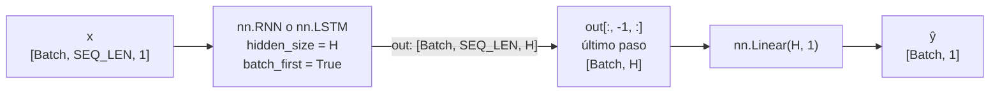

| Capa | `SimpleRNNModel` | `LSTMModel` | Forma de salida |
|---|---|---|---|
| Entrada | | | `[B, L, 1]` |
| Recurrente | `nn.RNN(1, H, batch_first=True)` | `nn.LSTM(1, H, batch_first=True)` | `out: [B, L, H]` |
| Selección | `out[:, -1, :]` | `out[:, -1, :]` | `[B, H]` |
| Salida | `nn.Linear(H, 1)` | `nn.Linear(H, 1)` | `[B, 1]` |
| Parámetros con H = 16 | 321 | 1,233 | |

`LSTMModel` es la clase de la guía tal cual: se reemplaza `nn.RNN` por `nn.LSTM`, que además del estado oculto `hn` retorna el estado de celda `cn`.

## 5. Datos y protocolo experimental

- **Serie:** $\sin(t)$ con 600 puntos en $t \in [0, 50]$, con $\Delta t \approx 0.0835$ (unos 75 puntos por periodo).
- **Ventanas deslizantes:** `X[i] = serie[i : i+L]` y `y[i] = serie[i+L]`, es decir, se predice el valor inmediatamente siguiente.
- **Partición cronológica 80/20:** el primer 80 % de las ventanas se usa para entrenar y el último 20 % para evaluar, sin mezclar. Los valores objetivo del tramo de prueba ($t \gtrsim 40$) nunca se ven durante el entrenamiento. El código base medía la pérdida sobre los mismos datos con los que entrenaba, y esta partición permite evaluar **predicción** sobre datos nuevos.
- **Entrenamiento igual al código base:** `MSELoss`, `Adam(lr=0.01)`, 50 épocas y el batch completo en cada época.
- **Condiciones idénticas:** todos los modelos comparten datos, partición, épocas, tasa de aprendizaje, optimizador y las mismas 5 semillas (0 a 4). Solo cambia la arquitectura o el hiperparámetro que se estudia.
- **Métricas:**
  - *Loss train final*: MSE de entrenamiento en la última época.
  - *MSE / RMSE / R² de prueba*: calidad de la predicción en el tramo no visto.
  - *Oscilaciones*: cantidad de épocas en las que la pérdida **subió** respecto a la anterior (de 49 transiciones). Mide la estabilidad de la convergencia.
  - *Norma máxima del gradiente* ‖∇L‖: los picos indican pasos de entrenamiento bruscos o inestables.
  - *Sensibilidad temporal* $s_k$: promedio de $|\partial \mathcal{L} / \partial x_{T-k}|$ sobre las ventanas de prueba, normalizado a 1, donde $k$ son los pasos hacia atrás desde la predicción. Mide cuánta señal de gradiente llega a cada paso de la entrada. Ajustamos $s_k \approx C\rho^k$ y definimos la **vida media** como $\ln 0.5 / \ln \rho$ pasos.
  - *Compuerta de olvido media* $\bar f$ (solo en la LSTM).

**Cambios respecto al código base.** La lógica del código base se mantiene: el bucle `zero_grad → backward → step` con el `print` cada 10 épocas sigue dentro de `entrenar()`, y el código original sin cambios está en el segundo commit del historial. Los cambios fueron:

1. Agregamos `np.array(X)` antes de `torch.tensor(...)`. Así se elimina el `UserWarning` *"Creating a tensor from a list of numpy.ndarrays is extremely slow"* que daba el código original.
2. Organizamos el código en funciones (`generar_datos`, `entrenar`, `evaluar`, `repetir_experimento`, …) para repetir cada experimento bajo las mismas condiciones.
3. Agregamos la partición cronológica, las métricas de prueba, las gráficas y `metricas.json`.

## 6. Actividad 1: inspección de dimensiones

Antes de entrenar, el script ejecuta `print(X.shape)` y sigue la forma del tensor dentro del modelo:

```text
X.shape: torch.Size([590, 10, 1])
y.shape: torch.Size([590, 1])
Partición cronológica 80/20: X_train (472, 10, 1) · X_test (118, 10, 1)

Flujo de dimensiones dentro de SimpleRNNModel:
  x                      (590, 10, 1)    entrada
  out, h_n = rnn(x)      (590, 10, 16)   out: h_t de los 10 pasos (hidden_size = 16)
                         (1, 590, 16)    h_n: último estado oculto [num_layers, Batch, Hidden]
  out[:, -1, :]          (590, 16)       solo el último paso temporal (Many-to-One)
  pred = fc(out_final)   (590, 1)        una predicción por ventana
  ¿out[:, -1, :] es igual a h_n[0]? True
```

| Eje / tensor | Valor | Qué representa |
|---|---|---|
| **Eje 0 · Batch Size** | 590 | Número de ventanas deslizantes: 600 puntos − 10 = 590 muestras independientes. Como el entrenamiento usa el batch completo, la red procesa las 590 a la vez. |
| **Eje 1 · Sequence Length** | 10 | Pasos temporales consecutivos de cada ventana. La celda recurrente se aplica 10 veces con los mismos pesos. |
| **Eje 2 · Features** | 1 | Variables por paso. La serie es univariada (solo $\sin(t)$), por eso coincide con `input_size=1`. |
| `y` | `[590, 1]` | Un objetivo por ventana: el valor siguiente de la serie. |
| `out` | `[590, 10, 16]` | El estado oculto $h_t$ en cada uno de los 10 pasos, con 16 neuronas cada uno. |
| `h_n` | `[1, 590, 16]` | El último estado oculto. Su primer eje es `num_layers × num_directions`. **No** sigue `batch_first` aunque el modelo lo use. |
| `out[:, -1, :]` | `[590, 16]` | El último paso temporal, que es lo que hace al modelo *Many-to-One*. Es idéntico a `h_n[0]` (verificado: `True`). |

Hay dos detalles que conviene notar:

- `unsqueeze(-1)` agrega el eje de *features*. Sin él, `X` sería `[590, 10]` y PyTorch lo leería como **una sola secuencia sin batch** de 590 pasos con 10 *features*, lo que choca con `input_size=1`.
- `batch_first=True` hace que PyTorch lea el tensor como `[Batch, Seq, Features]`. Sin esa opción interpretaría `[590, 10, 1]` como 590 pasos de un batch de 10.

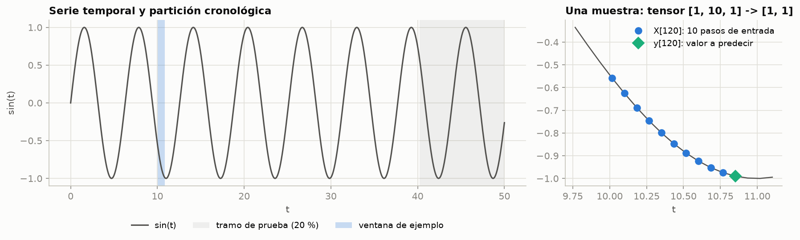

## 7. Modelo base: RNN simple

Este es el código base de la guía (H = 16, `SEQ_LEN = 10`, 50 épocas) con la partición cronológica:

```text
Epoch [10/50], Loss: 0.131990
Epoch [20/50], Loss: 0.047066
Epoch [30/50], Loss: 0.019789
Epoch [40/50], Loss: 0.006840
Epoch [50/50], Loss: 0.003089
¡Entrenamiento de la RNN Simple finalizado con éxito!
Predicción sobre el tramo de prueba: MSE = 0.003083 · RMSE = 0.0555 · MAE = 0.0492 · R² = 0.9932
```

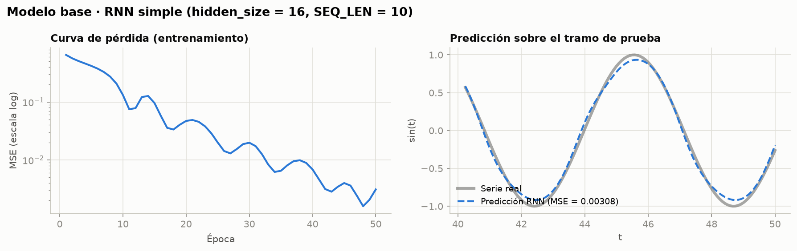

- En 50 épocas la pérdida baja más de dos órdenes de magnitud, pero **no de forma monótona**: hay repuntes, por ejemplo alrededor de las épocas 12-14 y 20. Es lo habitual con Adam (`lr = 0.01`) y gradiente de batch completo.
- En el tramo de prueba la predicción sigue bien la fase de la onda (R² = 0.993). Sin embargo, **subestima los picos y los valles** (llega a ≈ ±0.93), y ahí se concentra el error.

## 8. Actividad 2: modificación de hiperparámetros

Así se distribuyen los parámetros por tensor, calculados con `sum(p.numel() for p in model.parameters())`:

| Parámetro | Forma (H = 16) | Cantidad | Forma (H = 64) | Cantidad |
|---|---|---:|---|---:|
| `rnn.weight_ih_l0` ($W_{ih}$) | (16, 1) | 16 | (64, 1) | 64 |
| `rnn.weight_hh_l0` ($W_{hh}$) | (16, 16) | 256 | (64, 64) | 4,096 |
| `rnn.bias_ih_l0` | (16,) | 16 | (64,) | 64 |
| `rnn.bias_hh_l0` | (16,) | 16 | (64,) | 64 |
| `fc.weight` | (1, 16) | 16 | (1, 64) | 64 |
| `fc.bias` | (1,) | 1 | (1,) | 1 |
| **Total** | | **321** | | **4,353** |

```math
P_{\text{RNN}} = \underbrace{H\cdot I}_{W_{ih}} + \underbrace{H^2}_{W_{hh}} + \underbrace{2H}_{b_{ih},\,b_{hh}} + \underbrace{O\cdot H + O}_{\text{capa lineal}} \;=\; H^2 + 4H + 1 \quad (I = O = 1)
```

```math
P_{\text{LSTM}} = 4\left(H\cdot I + H^2 + 2H\right) + O\cdot H + O \;\Rightarrow\; 1{,}233 \ (H = 16), \quad 17{,}217 \ (H = 64)
```

El script verifica que ambas fórmulas coinciden con el conteo de PyTorch.

- **El crecimiento es cuadrático.** Multiplicar las neuronas por 4 multiplica los parámetros por **13.56**, porque el término recurrente $H^2$ domina. $W_{hh}$ es el 80 % de los parámetros con H = 16 y el **94 %** con H = 64.
- **Los parámetros no dependen de `SEQ_LEN`.** Por el reciclaje de pesos, la RNN tiene 321 parámetros tanto con 10 como con 50 pasos (ver la tabla de la Actividad 3).
- **Hay dos vectores de sesgo.** PyTorch usa $b_{ih}$ y $b_{hh}$, que matemáticamente son redundantes porque solo importa su suma. Se mantienen por compatibilidad con cuDNN, y de ahí sale el término $2H$.
- **La LSTM tiene cuatro bloques recurrentes**, uno por compuerta ($i, f, \tilde c, o$). Por eso, con el mismo `hidden_size`, tiene unas 4 veces más parámetros que la RNN.

**Impacto en el entrenamiento** (`SEQ_LEN = 10`, 5 semillas):

| Modelo | Parámetros | Loss train final | MSE de prueba | R² | Oscil. | ‖∇L‖ máx |
|---|---:|---:|---:|---:|---:|---:|
| RNN · H = 16 | 321 | 0.002875 ± 0.000808 | 0.002807 ± 0.000986 | 0.9938 | 17.4 | 1.39 |
| RNN · H = 64 | 4,353 | 0.000867 ± 0.000495 | 0.000905 ± 0.000536 | 0.9980 | 18.8 | **7.26** |

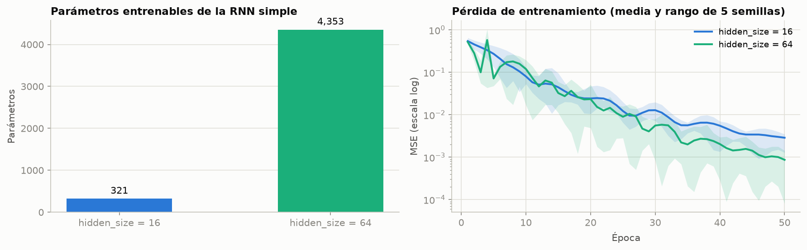

Con más capacidad, el error de prueba baja **3.1 veces**, pero el costo es la estabilidad: la norma máxima del gradiente es 5.2 veces mayor y en las primeras épocas la pérdida rebota (en una semilla llega a 1.04, ver la banda verde). Esto no ocurre con H = 16. Es decir, se necesitan 13.6 veces más parámetros para una mejora de 3.1 veces. En CPU el tiempo por época casi no cambia (0.8 → 1.0 ms) porque el problema es muy pequeño.

## 9. Actividad 3: análisis de ventanas temporales

RNN simple (H = 16) con `SEQ_LEN = 10` y `SEQ_LEN = 50`:

| Ventana | Loss train final | MSE de prueba | R² | Oscil. | ‖∇L‖ máx | ms/época |
|---|---:|---:|---:|---:|---:|---:|
| `SEQ_LEN = 10` | 0.002875 ± 0.000808 | 0.002807 ± 0.000986 | 0.9938 | 17.4 | 1.39 | 0.8 |
| `SEQ_LEN = 50` | 0.001624 ± 0.000636 | 0.001574 ± 0.000794 | 0.9966 | 17.4 | 1.35 | 2.8 |

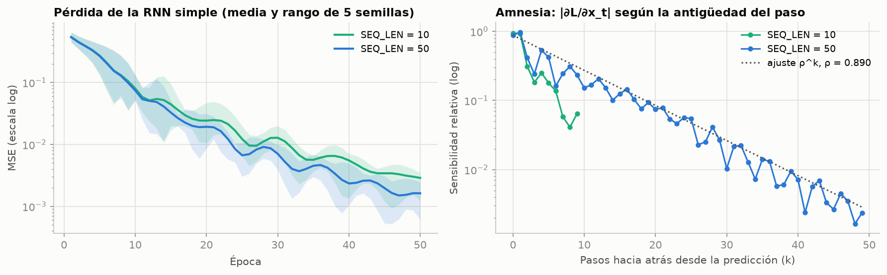

1. **Estabilidad de la pérdida.** Pasar a 50 pasos **no** hace diverger ni explotar el entrenamiento en este problema. El número de oscilaciones es el mismo (17.4), la norma máxima del gradiente es similar (1.35 frente a 1.39) y la pérdida final es incluso menor. Una explicación probable es que el siguiente valor del seno depende solo del pasado reciente (ver la sección 12). Con 50 pasos, además, el estado oculto tiene tiempo de "olvidar" su condición inicial arbitraria $h_0 = 0$ antes de predecir, mientras que con 10 pasos parte de ese transitorio todavía llega al estado final.
2. **Costo.** BPTT desenrolla 50 pasos que deben procesarse en secuencia, así que el tiempo por época sube **3.5 veces** (0.8 → 2.8 ms). La memoria de activaciones también crece linealmente con `SEQ_LEN`.
3. **Amnesia matemática (panel derecho).** Con 50 pasos, la sensibilidad sigue un decaimiento exponencial $s_k \approx C \cdot 0.890^k$:
   - Cada paso hacia atrás pierde un 11 % de la señal, así que la vida media es de **≈ 5.9 pasos**.
   - El paso más antiguo recibe el **0.238 %** de la señal del más reciente, unas 420 veces menos.
   - Los 10 pasos más recientes concentran el **69.2 %** de la sensibilidad total. Los 40 más antiguos, que son el 80 % de la ventana, reciben solo el 30.8 %.

   Si el valor a predecir dependiera de algo ocurrido 50 pasos antes, la RNN recibiría una señal de gradiente 420 veces más débil para aprenderlo. Esa es la "amnesia matemática": el producto de Jacobianas $\mathrm{diag}(1-h^2)\cdot W_{hh}$ de la sección 3.2, ahora medido en los datos.

**Conclusión de la actividad:** en este problema, alargar la ventana no rompe el entrenamiento de la RNN, pero tampoco le da memoria útil. Lo que se agrega al inicio de la ventana le llega a través de una señal atenuada exponencialmente.

## 10. Reto avanzado: LSTM frente a RNN simple

Entrenamos los dos modelos de la guía bajo condiciones idénticas (`SEQ_LEN = 50`, H = 16, mismos datos, épocas, `lr` y semillas). Además agregamos un **control de capacidad**: una RNN con H = 33, que tiene prácticamente los mismos parámetros que la LSTM.

| Modelo | Parámetros | Loss train final | MSE de prueba | R² | Oscil. | ‖∇L‖ máx | ms/época |
|---|---:|---:|---:|---:|---:|---:|---:|
| RNN · H = 16 | 321 | 0.001624 ± 0.000636 | 0.001574 ± 0.000794 | 0.9966 | 17.4 | 1.35 | 2.8 |
| **LSTM · H = 16** | 1,233 | 0.000665 ± 0.000300 | **0.000539 ± 0.000112** | 0.9988 | **9.6** | **0.58** | 6.9 |
| RNN · H = 33 (control) | 1,222 | 0.000451 ± 0.000292 | 0.000470 ± 0.000220 | 0.9990 | 19.0 | 2.18 | 3.7 |

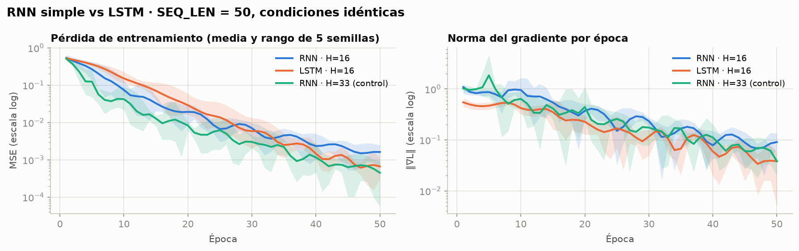

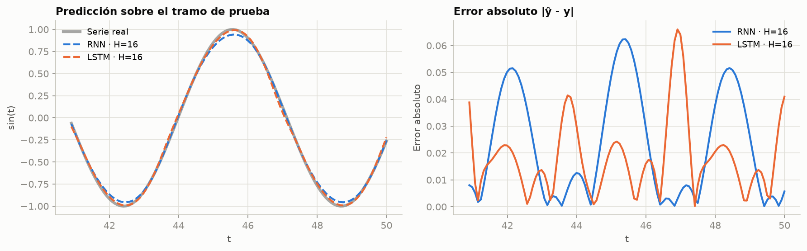

### Respuesta a la pregunta de análisis

**Con secuencias de 50 pasos, la LSTM se ajusta mejor a la serie temporal que la RNN simple:**

- **Menor error.** El MSE de prueba es 0.000539 frente a 0.001574 (2.9 veces menos), el RMSE 0.0231 frente a 0.0381 y el R² 0.9988 frente a 0.9966.
- **Curva de convergencia.** La LSTM arranca más lento: en la época 10 su pérdida es 0.151 y la de la RNN 0.074, porque tiene más parámetros que coordinar y sus compuertas empiezan cerca de 0.5. A partir de la **época 34** supera a la RNN de forma definitiva y termina con una pérdida 2.4 veces menor (0.000665 frente a 0.001624).
- **Convergencia más estable.** La LSTM tiene casi la mitad de oscilaciones (9.6 frente a 17.4) y una norma máxima del gradiente de 0.58 frente a 1.35. Su desviación entre semillas es **7 veces menor** (0.000112 frente a 0.000794): llega a casi el mismo resultado sin importar la inicialización.
- **Calidad de la predicción (figura 06).** La RNN subestima sistemáticamente los picos y los valles, y su error se concentra en ±1. El error de la LSTM está más repartido y es menor en promedio.

**¿Por qué?** Las compuertas sigmoides, con valores entre 0 y 1, regulan de forma multiplicativa cuánto pasa de cada señal. Además, el camino aditivo de la celda ($c_t = f_t \odot c_{t-1} + i_t \odot \tilde c_t$) evita que todo el gradiente tenga que pasar por $\tanh'$ y $W_{hh}$ en cada paso. El resultado son gradientes más pequeños y regulares (panel derecho de la figura 05), con los que Adam da pasos más consistentes.

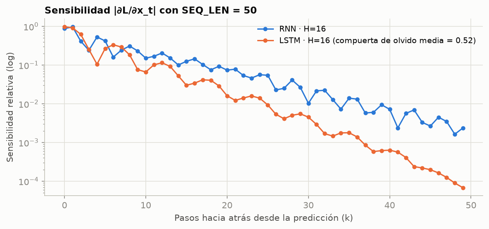

## 11. Impacto de incrementar la longitud de la secuencia

Para evaluar el efecto de alargar la ventana más allá de lo que pide la guía, hicimos un barrido con `SEQ_LEN` ∈ {10, 25, 50, 100}. La tabla muestra el MSE de prueba (media ± desviación de 5 semillas):

| `SEQ_LEN` | RNN · H = 16 | LSTM · H = 16 | RNN · H = 33 (control) |
|---:|---:|---:|---:|
| 10 | 0.002807 ± 0.000986 | 0.002600 ± 0.001162 | 0.000753 ± 0.000310 |
| 25 | 0.001057 ± 0.000825 | 0.000570 ± 0.000155 | 0.000324 ± 0.000206 |
| 50 | 0.001574 ± 0.000794 | 0.000539 ± 0.000112 | 0.000470 ± 0.000220 |
| 100 | 0.001303 ± 0.000684 | 0.000551 ± 0.000109 | **0.005706 ± 0.009272** |

| `SEQ_LEN` | ms/época RNN · 16 | ms/época LSTM · 16 | Señal en el paso más antiguo (RNN · 16) | Señal en el paso más antiguo (LSTM · 16) |
|---:|---:|---:|---:|---:|
| 10 | 0.8 | 1.6 | 6.5 × 10⁻² | 4.8 × 10⁻² |
| 25 | 1.5 | 3.5 | 3.0 × 10⁻² | 4.9 × 10⁻³ |
| 50 | 2.8 | 6.9 | 2.4 × 10⁻³ | 6.8 × 10⁻⁵ |
| 100 | 5.1 | 13.0 | 3.8 × 10⁻⁵ | 3.0 × 10⁻⁸ |

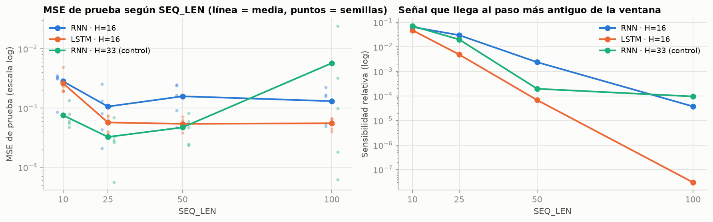

1. **Pasar de 10 a 25 pasos mejora a todos los modelos**, porque hay más contexto para identificar la fase y se diluye el transitorio inicial. **Por encima de 25 ya no hay ganancia:** la LSTM se estabiliza en ≈ 0.00055 y la RNN con H = 16 oscila entre 0.0011 y 0.0016.
2. **El costo crece linealmente con la longitud**, porque BPTT es secuencial y no se paraleliza en el eje temporal. La LSTM pasa de 1.6 a 13.0 ms por época y la RNN de 0.8 a 5.1 ms.
3. **La señal que llega al primer paso colapsa exponencialmente.** En la RNN baja de 6.5 × 10⁻² a 3.8 × 10⁻⁵ entre 10 y 100 pasos. Con 100 pasos, la primera entrada es prácticamente invisible para el gradiente.
4. **Las secuencias largas son donde la LSTM muestra su ventaja.** Con 100 pasos, la RNN de capacidad equivalente se vuelve inestable: en una semilla la norma del gradiente llega a **10.9** y el MSE de prueba a **0.024**, 44 veces peor que la LSTM. Su promedio queda en 0.0057 ± 0.0093. En la LSTM, la norma máxima del gradiente queda por debajo de 0.7 en todas las semillas y el MSE se mantiene entre 0.00054 y 0.00057 en todas las longitudes ≥ 25.

## 12. Análisis crítico y limitaciones

**1. ¿La LSTM gana por sus compuertas o por tener más parámetros?** Con el mismo `hidden_size`, la LSTM tiene 3.8 veces más parámetros que la RNN (1,233 frente a 321). La RNN de control con H = 33 (1,222 parámetros) obtiene un MSE de 0.000470 ± 0.000220 con 50 pasos, que es **equivalente dentro de la variabilidad entre semillas** al de la LSTM (0.000539 ± 0.000112). Con 50 pasos, entonces, la ventaja en exactitud se explica sobre todo por la capacidad. Lo que la capacidad **no** explica es la estabilidad: la RNN de control oscila el doble (19.0 frente a 9.6), su gradiente máximo es 3.8 veces mayor (2.18 frente a 0.58) y falla con 100 pasos. Por lo tanto, en este problema la ventaja real de la LSTM no es una exactitud máxima más alta, sino un **entrenamiento robusto y predecible con secuencias largas**.

**2. Este problema casi no necesita memoria.** La onda seno muestreada cumple una recurrencia lineal exacta:

```math
\sin(t + \Delta) = 2\cos(\Delta)\,\sin(t) - \sin(t - \Delta)
```

Con los **dos** valores anteriores se puede predecir el siguiente sin error; un modelo lineal AR(2) sería perfecto. Eso explica que alargar la ventana por encima de 25 pasos no mejore nada. También explica que la LSTM entrenada **no use** su memoria larga: su sensibilidad decae incluso más rápido que la de la RNN (ρ = 0.834, y el paso más antiguo recibe 6.8 × 10⁻⁵). Su compuerta de olvido media se queda en ≈ 0.5 (0.497 al inicializar y 0.524 después de entrenar), porque nada en la tarea la empuja a abrirla. La diferencia con la RNN es que en la LSTM olvidar es una **decisión controlable** (la compuerta $f_t$ se entrena), mientras que en la RNN es una **limitación estructural** del producto de Jacobianas.

**3. Cómo verificar la memoria larga de la LSTM.** Habría que usar tareas con dependencias lejanas (el problema de la suma, la copia de secuencias o series con estacionalidad larga y ruido), entrenar más épocas e inicializar el sesgo de la compuerta de olvido en 1 (Jozefowicz et al., 2015).

**4. Limitaciones del experimento:**

- Los datos son sintéticos y sin ruido.
- Hay una sola partición cronológica, sin validación cruzada temporal.
- Las 50 épocas son fijas y ninguna curva de pérdida está del todo estabilizada al final, así que con más épocas las diferencias podrían cambiar.
- Los modelos tienen una sola capa.
- Los tiempos se midieron en CPU y varían entre ejecuciones; solo sirven como comparación relativa.

## 13. Conclusiones

1. Implementamos la RNN simple y la LSTM con tensores tridimensionales `[Batch, Sequence Length, Features]` bajo el paradigma *Many-to-One*. Ambas predicen el tramo de prueba con R² > 0.99.
2. Los parámetros crecen de forma **cuadrática** con `hidden_size` (por el término $H^2$) y **no dependen** de la longitud de la secuencia (reciclaje de pesos). La LSTM tiene cuatro bloques recurrentes, uno por compuerta.
3. La RNN simple muestra la **amnesia matemática** que predice la teoría de BPTT: la señal de gradiente cae un 11 % por paso, y con 50 pasos la entrada más antigua recibe solo el 0.24 %.
4. Con 50 pasos y condiciones idénticas, **la LSTM se ajusta mejor**: 2.9 veces menos MSE de prueba, convergencia más suave y resultados más consistentes entre semillas.
5. Con igual número de parámetros, la RNN alcanza la exactitud de la LSTM con 50 pasos, pero es menos estable y falla con 100. La ventaja decisiva de la LSTM aquí es su **robustez ante secuencias largas**, a cambio de unas 2.5 veces más tiempo por época.

## 14. Control de versiones

Historial de commits, en orden:

| # | Commit | Contenido |
|---|---|---|
| 1 | `chore: configuracion inicial del proyecto (.gitignore y requirements.txt)` | Archivos de configuración |
| 2 | `feat: modelo base RNN simple Many-to-One sobre onda senoidal` | Código base de la guía, sin cambios |
| 3 | `feat: actividades practicas de dimensiones, hiperparametros y ventanas temporales` | Refactorización en funciones, partición train/test y actividades 1 a 3 |
| 4 | `feat: modelo LSTM y comparacion con la RNN simple en secuencias largas` | `LSTMModel`, reto, control de capacidad y barrido de `SEQ_LEN` |
| 5 | `feat: resultados de los experimentos (graficas, metricas y salida de consola)` | Contenido de `resultados/` |
| 6 | `docs: README con arquitectura, actividades y analisis comparativo RNN vs LSTM` | Este documento |
| 7 | `docs: capturas de pantalla de la ejecucion en VS Code y del repositorio en GitHub` | Carpeta `capturas/` y sección 15 |
| 8 | `docs: corrige ecuaciones del README para el renderizado de GitHub` | `\operatorname` → `\mathrm`, que GitHub sí permite |
| 9 | `docs: corrige espaciado de ecuaciones en linea del README` | Quita `\,` dentro de `$...$`, que GitHub mostraba como coma |

Comandos usados, siguiendo la sección 6 de la guía. Hicimos un commit por cada etapa del desarrollo en lugar de un único commit inicial:

```bash
git init
git branch -M main
git add .gitignore requirements.txt
git commit -m "chore: configuracion inicial del proyecto (.gitignore y requirements.txt)"
# ... se repite git add / git commit en cada etapa (tabla anterior)
git remote add origin https://github.com/luid-dev/guia06-rnn-lstm-pytorch.git
git push -u origin main
```

## 15. Evidencias de ejecución y publicación

### Ejecución en VS Code

Ejecutamos el script como tarea de VS Code (`source venv/bin/activate && python practica_rnn.py`) en la terminal integrada. Los tiempos por época cambian un poco entre ejecuciones, pero las métricas de error son idénticas a las de las tablas.

**1. Código y ejecución del script.** El final de la salida muestra la respuesta a la pregunta de análisis y el barrido de `SEQ_LEN`.

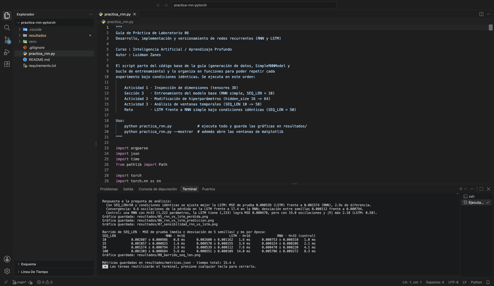

**2. Inicio de la salida.** Actividad 1 (dimensiones de los tensores), entrenamiento del modelo base y desglose de parámetros de la Actividad 2.

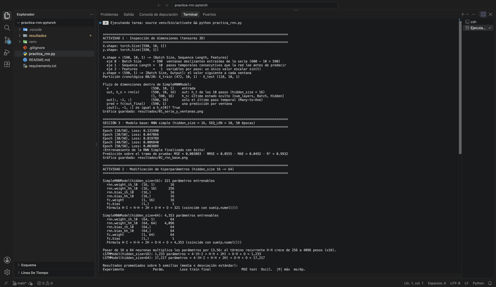

**3. Final de la salida.** Tablas de las Actividades 2 y 3, memoria efectiva, reto LSTM y barrido de longitudes.

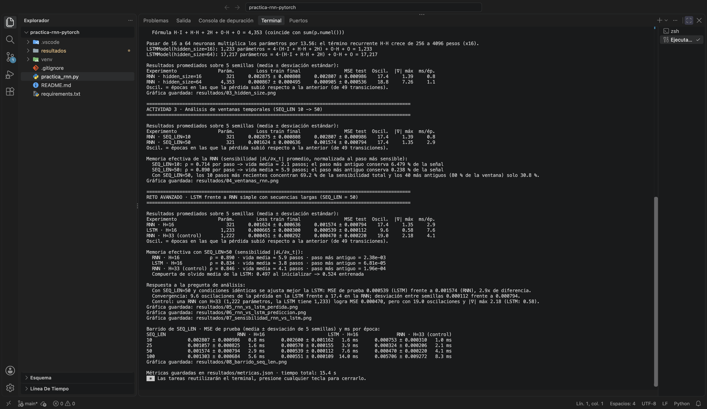

**4. Clase `LSTMModel` en el editor.**

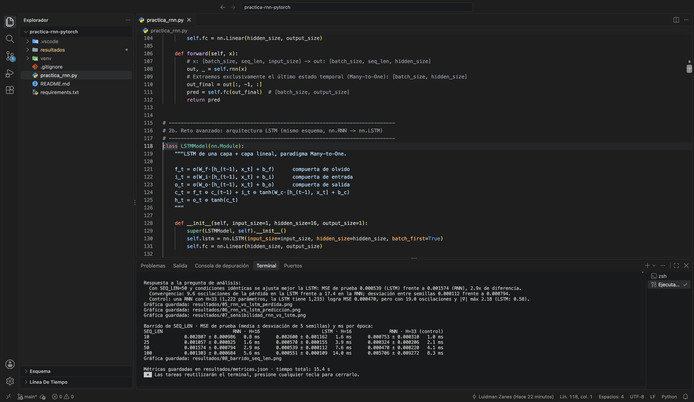

### Repositorio publicado en GitHub

**5. Repositorio público** con la estructura solicitada (`practica_rnn.py`, `README.md`, `.gitignore`) y un único contribuidor.


**6. Historial de commits 1 a 6**, hasta el commit del README. Los commits siguientes agregan estas capturas y corrigen el formato del README.

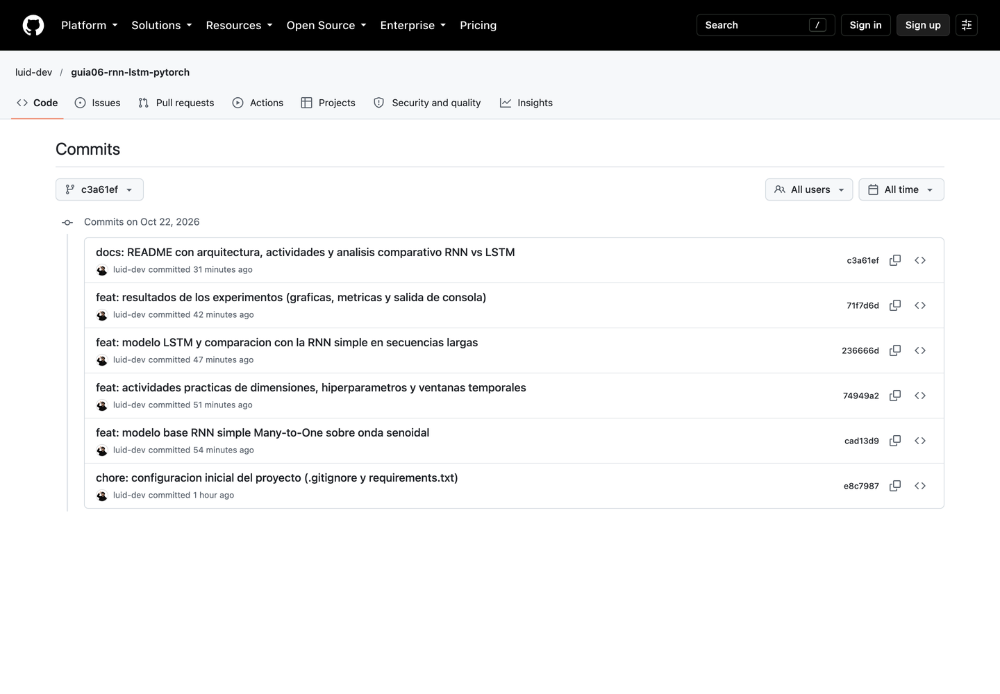

## 16. Referencias

- Hochreiter, S., & Schmidhuber, J. (1997). Long Short-Term Memory. *Neural Computation, 9*(8), 1735-1780.
- Bengio, Y., Simard, P., & Frasconi, P. (1994). Learning long-term dependencies with gradient descent is difficult. *IEEE Transactions on Neural Networks, 5*(2), 157-166.
- Pascanu, R., Mikolov, T., & Bengio, Y. (2013). On the difficulty of training recurrent neural networks. *Proceedings of the 30th International Conference on Machine Learning (ICML)*.
- Jozefowicz, R., Zaremba, W., & Sutskever, I. (2015). An empirical exploration of recurrent network architectures. *Proceedings of the 32nd International Conference on Machine Learning (ICML)*.
- Goodfellow, I., Bengio, Y., & Courville, A. (2016). *Deep Learning*, capítulo 10: Sequence Modeling: Recurrent and Recursive Nets. MIT Press.
- Documentación de PyTorch: [`torch.nn.RNN`](https://pytorch.org/docs/stable/generated/torch.nn.RNN.html) y [`torch.nn.LSTM`](https://pytorch.org/docs/stable/generated/torch.nn.LSTM.html).
